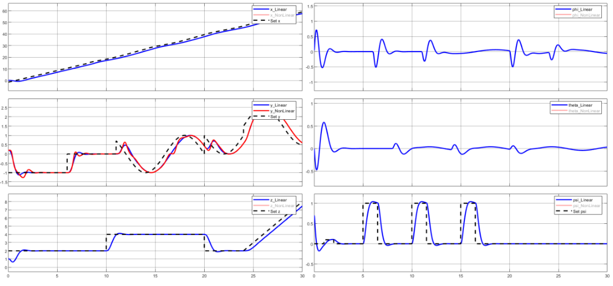

# Quadcopter Position Control

**MATLAB and Simulink modeling, position tracking, and state estimation for a quadcopter.** This project develops a 12-state nonlinear model, linearizes it around hover, and studies state-feedback and LQR controllers for position and yaw tracking. Three development phases are kept together with their live scripts, simulation models, and reports.

## Project overview

| Phase | Focus | Main work |
| --- | --- | --- |
| [01 - Modeling and analysis](phases/01_modeling_and_analysis/README.md) | Understand the aircraft dynamics | Nonlinear equations, hover linearization, state-space and transfer-function analysis, stability, controllability, observability, and linear/nonlinear comparisons |
| [02 - Position tracking](phases/02_position_tracking/README.md) | Stabilize and track reference commands | Pole-placement state feedback, LQR, static precompensation, and integral tracking with an augmented model |
| [03 - Observers and robustness experiments](phases/03_observers_and_robustness/README.md) | Estimate states and study practical effects | Full-order and reduced-order observers, actuator saturation/lag branches, noise, MAE comparison, and a 20% state-matrix mismatch scenario |

**Tools:** MATLAB, Simulink, Control System Toolbox, and Symbolic Math Toolbox. The final model also contains optional 3D visualization references and disabled experimental branches; see [run notes](docs/RUNNING.md).

## Model and control approach

The state vector is

```text
X = [x, x_dot, y, y_dot, z, z_dot, phi, theta, psi, p, q, r]^T
```

The four control inputs are total thrust and roll, pitch, and yaw torques. The measured output used for observer design is `[x, y, z, psi]^T`. At hover, total thrust is `m*g`; the linear model uses deviations from that operating point.

The tracking controller extends the 12-state hover model with four integral-error states. LQR then produces a gain for the resulting 16-state system. Full-order and eight-state reduced-order observer experiments estimate unmeasured motion states from position/yaw measurements.

See [model details and parameter changes](docs/MODEL.md).

## Example saved result



This figure is extracted from the final supplied report. It compares linear and nonlinear responses in the illustrated tracking experiment. It is historical evidence, not a newly reproduced simulation.

## Results and interpretation

- Independent matrix checks confirm that the nominal hover model has 12 controllable and 12 observable states. Its open-loop integrator chains require stabilization.
- The scripts include pole-placement feedback and LQR designs, including four-channel integral tracking.
- The final report compares full-order and reduced-order observer MAE under nominal, noisy, and `A_plant = 1.2*A_nominal` scenarios. The illustrated full-order observer performs better for the selected configurations; this is not a general ranking of observer types.
- The archive does not include raw simulation logs or a consolidated numerical benchmark. MATLAB/Simulink simulations were not rerun when preparing this repository.

Several report settings differ from the saved live script. The final model also contains commented-out observer-feedback, motor, and Kalman-filter experiments. The repository documents those differences rather than claiming that every branch forms a validated end-to-end system. See [results and limitations](docs/RESULTS.md).

## Getting started

```bash
git clone https://github.com/Arian-Abdollahi/quadcopter-position-control.git
```

Open the repository folder in MATLAB, then select a phase:

```matlab
open_phase(3)   % 1: modeling; 2: tracking; 3: observers
```

This opens the selected live script and changes to that phase's folder. Run the relevant live-script sections to populate the base workspace. Then open its Simulink model:

```matlab
open_system('Main.slx')  % phases 2 and 3
% Phase 1 uses: open_system('Phase1_simulink.slx')
```

Inspect the saved switches, commented branches, solver settings, and scope connections before running a scenario. Both later models are named `Main`, so work with one phase at a time. Detailed setup, dependencies, and known source issues are in [docs/RUNNING.md](docs/RUNNING.md).

## Reports and source files

| Material | Location |
| --- | --- |
| Original live scripts and Simulink models | Separate folders under `phases/` |
| GitHub-readable MATLAB code | `analysis_export.m` inside each phase folder |
| Modeling report | [01_modeling_and_analysis.pdf](reports/01_modeling_and_analysis.pdf) |
| Tracking report | [02_position_tracking.pdf](reports/02_position_tracking.pdf) |
| Final observer/control report | [03_observers_and_robustness.pdf](reports/03_observers_and_robustness.pdf) |
| Team attribution | [CREDITS.md](CREDITS.md) |
| Source provenance and packaging checks | [SOURCE_MANIFEST.json](docs/SOURCE_MANIFEST.json), [VERIFICATION.md](docs/VERIFICATION.md) |

Reports are in Persian. Their introductory covers are omitted and brief framing terms have been removed for a project-focused presentation. Technical content and figures are retained. No hardware flight validation is included.
