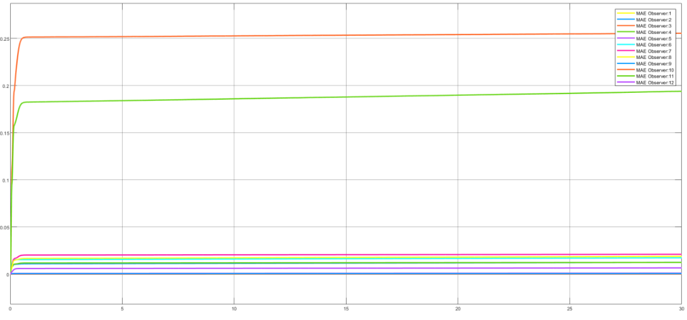

# Results and evidence

## What the sources support

The three phase reports and supplied live scripts document nonlinear modeling, local linear analysis, feedback stabilization, tracking precompensators, LQR design, and observer comparisons. Saved response figures are included in the reports and two are extracted under `assets/` for convenient viewing.

The final report compares nominal observer errors, measurement-noise experiments, and a state-matrix mismatch scenario using `A_plant=1.2*A_nominal`. Its illustrations show higher errors for the selected reduced-order observer and smaller errors for the selected full-order observer. These observations are configuration-specific and do not establish that reduced-order observers are inherently less accurate or less robust.

Figure source: final supplied report, source page 61, published report page 60. Tracking example in the root README: source page 51, published page 50. Both figures are historical outputs; neither was generated by a new simulation during packaging.

## Metrics and missing data

The reports discuss per-state mean absolute estimation error and tracking error. For a fixed horizon `T`, the intended continuous-time metric is `MAE=(1/T)*integral(abs(error(t)),0,T)`. The final model includes corresponding MAE subsystems. Confirm their normalization and input signals for the chosen scenario before reporting new values.

No raw time series, final per-state numeric results table, or repeat-run summary was supplied. Numbers have not been read approximately from figures or presented as a new benchmark. Some figures show an evolving accumulated/normalized error over time; a final scalar MAE must be defined consistently before comparing runs.

The final report prints a different integral weight and different reduced-order observer matrices than the saved final live script. Consequently, opening the archive is not enough to guarantee exact reproduction of every report plot.

## Implemented scope and incomplete trials

Pole placement, state LQR, integral LQR, and full-/reduced-order observer calculations appear in the code. Saturation, motor-lag, noise, rate-transition, and MAE blocks appear in the final model, with several trial paths saved as commented out.

Some report prose discusses MPC, adaptive/robust control, or Kalman filtering more broadly. Those statements are not treated as completed implementations. The Kalman-filter and observer-feedback trial blocks are disabled in the supplied final model. No physical quadcopter flight test, autonomous navigation stack, or hardware deployment is included.

## Checks performed during preparation

The hover matrices were independently reconstructed from the supplied equations. Matrix dimensions, controllability/observability, integral augmentation, and nominal LQR closed-loop eigenvalue signs were checked numerically using Python/SciPy. These are algebraic consistency checks; they do not replace MATLAB/Simulink execution, nonlinear closed-loop tests, or actuator validation. See `VERIFICATION.md` for the recorded results.
